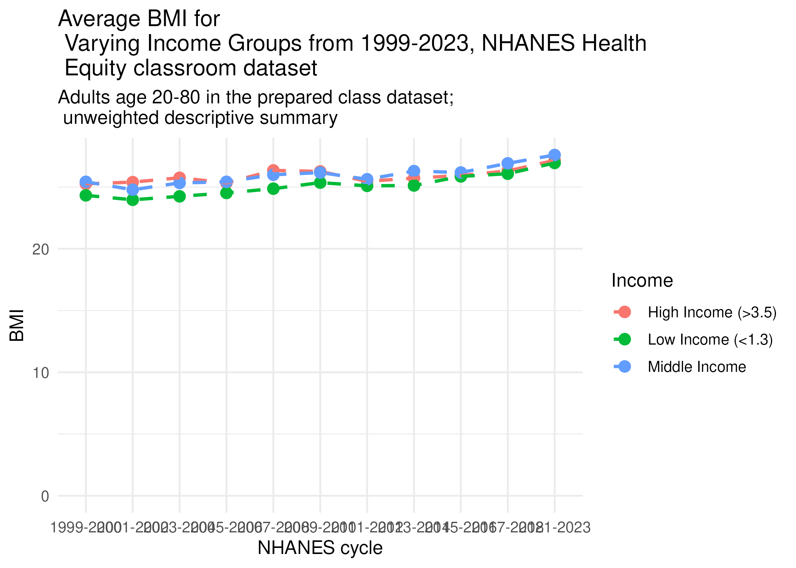

## Question And Audience

**Audience:** Policymakers

**Question:** How does average BMI, or body mass index, differ for low-, middle-, and high-income adults across NHANES survey cycles?

**Why it matters:** Since 1999, average BMI has risen across income groups. The increase was not the same for each group or every year. Policymakers can use this information to plan public health programs and direct resources.

## Evidence

Average BMI has risen across income groups since 1999, but the groups have risen at different rates.

**Caption:** This figure shows BMI by income group across yearly cycles using the prepared NHANES Health Equity classroom dataset. The summary is descriptive and unweighted. Records with missing BMI or Income classes were excluded. The plot supports comparison of patterns, not causal claims or population-level estimates.

**Source:** CDC/NCHS NHANES public-use data [@cdc-nhanes].

## Limitation And Next Step

**Limitation:** The plot does not include every survey cycle from 1999 to 2023. This makes long-term trends harder to see. It also does not adjust for age, sex, or race and ethnicity.

**Next step:** Study every survey cycle from 1999 to 2023. Use statistical methods to account for age, sex, race and ethnicity, and other factors that may affect BMI.

**AI-use note:** AI helped with simplifying the wording of my slides. AI prompt: "For each of these slides can you simplify wording to reduce the readability grade level for easier understand for policymakers and the general public?" Verified: Read through each of the revisions and ensured that information stated was still accurate and did not produce errors.